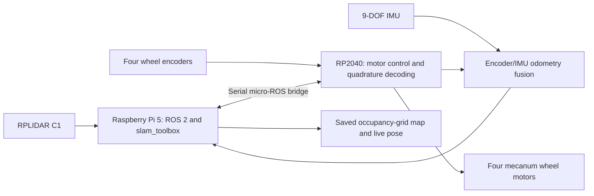

# LiDAR SLAM Mecanum Rover

A four-wheel mecanum rover that builds and saves LiDAR occupancy-grid maps and tracks its pose while driving. Motor control runs on an RP2040, while a Raspberry Pi 5 handles ROS 2 perception and SLAM.

**Project by Vraj Patel · July–August 2026**

## Demonstrated behaviour

- Generated and saved an occupancy-grid map of a real environment with RPLIDAR C1 and `slam_toolbox`.
- Tracked the rover's pose on the map while driving.
- Drove forward, strafed, and rotated under manual control.
- Verified the direction and encoder counts of all four wheel motors before driving.

These observations describe my completed hardware tests. Recorded demonstrations and the saved map are not included in this repository yet.

## Architecture

The diagram shows functional data flow; it is not a wiring diagram or an assertion about which processor hosts each fusion component.

## My contribution

- Split time-critical motor control from high-level perception and SLAM across the RP2040 and Raspberry Pi 5.
- Developed mecanum drive firmware and interrupt-driven quadrature decoding for four wheel encoders.
- Integrated the processors over a serial micro-ROS bridge.
- Integrated encoder odometry and a 9-DOF IMU for localization.
- Brought up the drive hardware and tested mapping, live localization, and omnidirectional teleoperation.

ROS 2, micro-ROS, and `slam_toolbox` provide the middleware and SLAM software. My work is the rover firmware, hardware integration, and system configuration; I did not author those upstream packages.

## Hardware and software

| Component | Role |
|---|---|
| Raspberry Pi 5 | High-level ROS 2 computation and SLAM |
| Raspberry Pi Pico / RP2040 | Motor control and wheel encoder decoding |
| RPLIDAR C1 | LiDAR input for mapping |
| BNO055 9-DOF IMU | Inertial data for localization |
| Four encoder motors and mecanum wheels | Omnidirectional drivetrain |
| ROS 2, micro-ROS, slam_toolbox | Communication, integration, and mapping |

## Repository status

This repository currently contains project documentation and a test summary. The RP2040 firmware, ROS workspace, configuration files, saved map, and media have not been uploaded. There is no runnable release here yet.

See [testing](docs/TESTING.md) for the demonstrated operating state and [media](media/README.md) for planned evidence.
